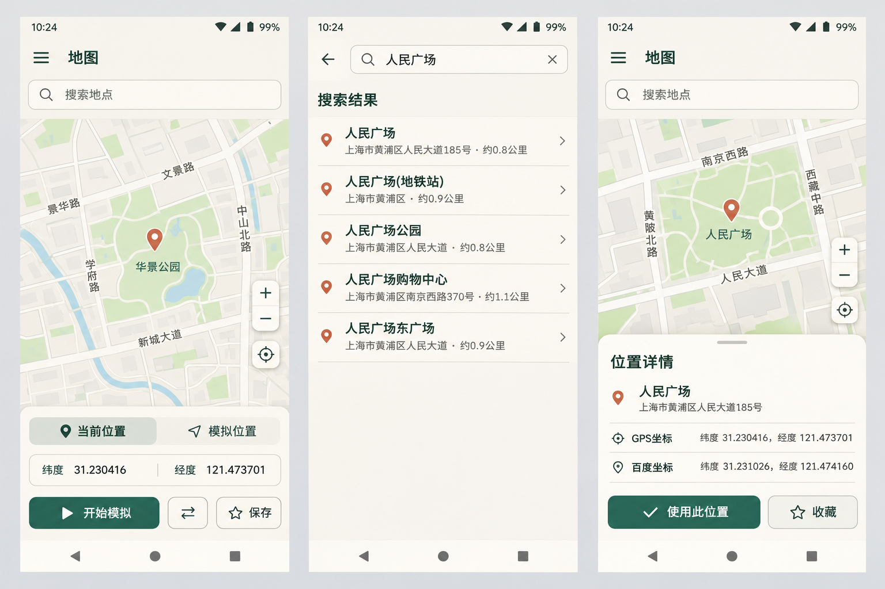
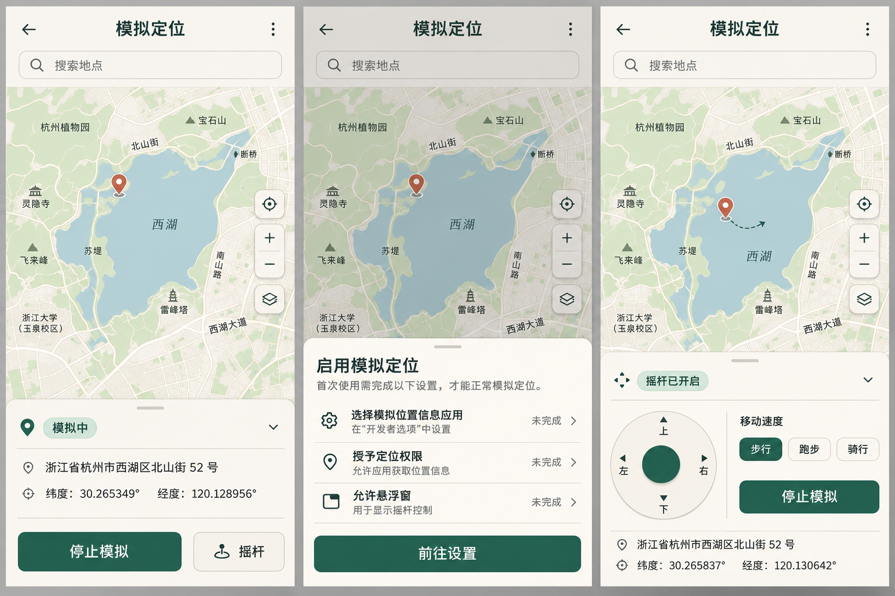
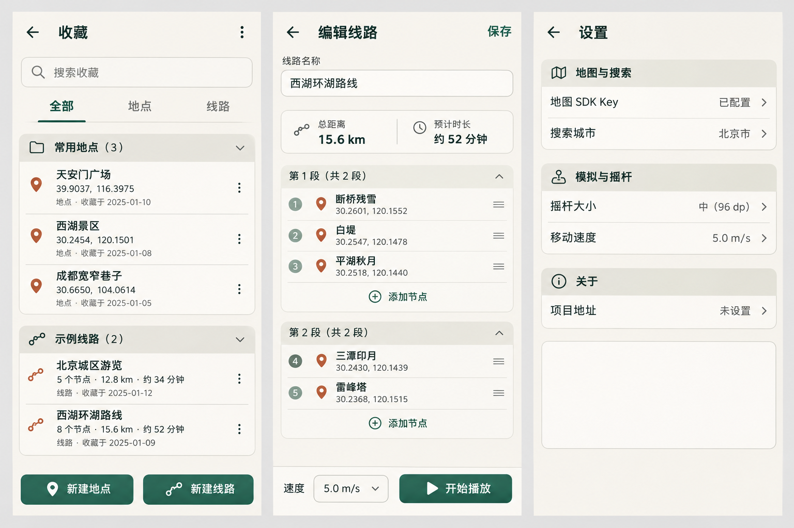
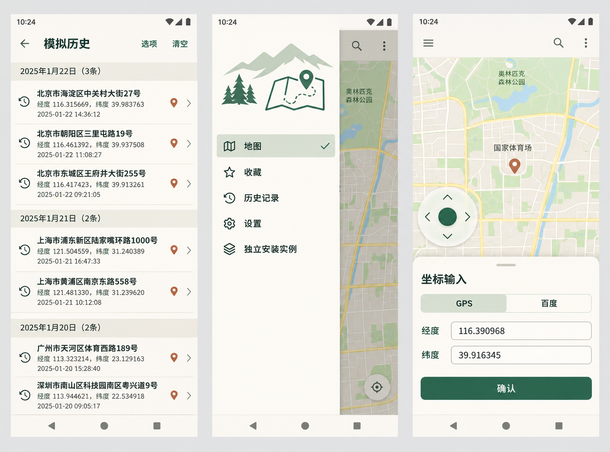
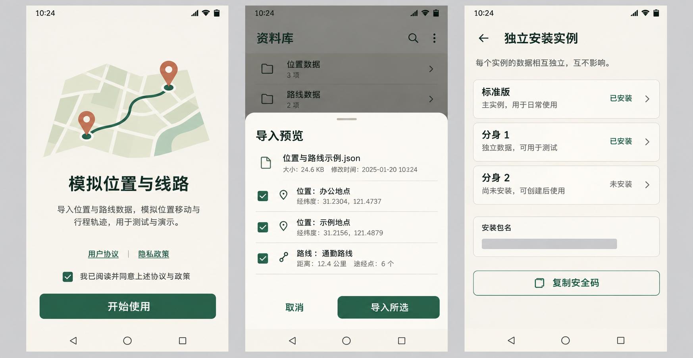
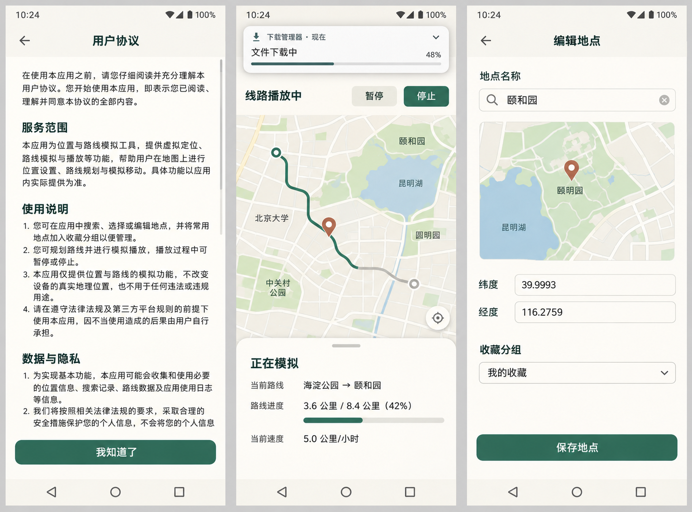

<p align="center">
  
</p>

<h1 align="center">穿梭（ChuanSuo）</h1>

<p align="center">
  <strong>当前版本 1.0.0</strong> · Android 8.1（API 27）及以上 · ARM64<br>
  开发者 · YH
</p>

穿梭是一款 Android 模拟定位应用。可在地图上选点、搜索地点或输入坐标，一键开始或停止固定位置模拟。运行时可用悬浮摇杆移动，也可从收藏启动线路播放。

[仓库](https://github.com/liuqingwlil/chuansuo-flue) · [版本与下载](https://github.com/liuqingwlil/chuansuo-flue/releases) · [界面预览](#界面设计预览) · [使用说明](docs/FEATURES.md) · [实现方案与范围](docs/IMPLEMENTATION_PLAN.md) · [English](README.en.md)

## 界面设计预览

### 地图选点与地点搜索

[](docs/images/ui/map-and-search.webp)

### 模拟定位与悬浮摇杆

[](docs/images/ui/simulation-states.webp)

<details>
<summary>更多界面设计</summary>

### 收藏、线路编辑与设置

[](docs/images/ui/collection-and-settings.webp)

### 历史、侧栏与坐标输入

[](docs/images/ui/history-and-overlays.webp)

### 欢迎页、导入预览与早期方案

[](docs/images/ui/onboarding-and-instances.webp)

### 用户协议、线路播放与地点编辑

[](docs/images/ui/policy-playback-and-place.webp)

</details>

<details>
<summary>界面图标</summary>

- [地图、收藏和播放图标](docs/images/ui/ui-icons.webp)
- [导航、移动和设置图标](docs/images/ui/navigation-icons.webp)

</details>

## 功能

- 百度地图选点、地点搜索、GPS/百度坐标输入，固定位置与悬浮摇杆移动。
- 收藏地点与线路，分组创建、重命名、排序、移动、置顶、搜索。删除组保留条目，历史过期不影响收藏。
- 线路编辑：地图/搜索/坐标/收藏添加节点，调整顺序、修改和删除节点，分段管理、距离与预计时长。
- 沿线路按设定速度移动，暂停、继续、运行中变速、停止、循环；通知和收藏页均提供控制入口。
- GPX 1.1 地点、线路与轨迹导入导出，保留轨迹分段、坐标、海拔及可选时间，导入前预览选择，批次写入失败回滚。

所有功能均不包含账号或付费权限要求。线路目前按节点间直线插值，不自动沿道路规划；分段之间瞬间切换，循环到终点后回到起点重新播放。GPX 时间戳用于保存与导出，播放使用设定速度。

## 地图配置

标准包名为 `com.chuansuo.app`。正式 APK 构建时通过本地配置注入百度地图 Android SDK Key，安装后可直接使用地图功能。开发版可在“设置 → 开发者工具”替换 Key，退出后重新打开应用生效。

地图授权需与 APK 的包名和签名匹配。系统模拟定位需要在 Android 开发者选项中选择穿梭为模拟位置信息应用。

搜索优先城市依次取用户设置、定位城市、北京，并允许跨城返回结果。主地图与悬浮地图共用输入防抖、旧结果过滤、建议词转 POI 与错误提示；线路编辑器也复用同一检索服务。

地图 SDK 联网与系统位置注入需要有效 Key 和 ARM64 真机验证，编译通过不代表已完成这些外部配置。官方参考：[输入提示](https://lbsyun.baidu.com/docs/android?title=androidsdk%2Fguide%2Fsearch%2Fsuggestion)、[Key 与签名](https://lbsyun.baidu.com/docs/guide?title=android-guide%2Fcreate-project%2Fak)。

## 构建与测试

使用 JDK 17、Android SDK Platform 32、Build Tools 36.0.0、Gradle Wrapper 8.13；原生库已预编译，无需 NDK。复制 `local.properties.example` 为 `local.properties`，填写本机 SDK 路径。

```powershell
.\gradlew.bat testDebugUnitTest
.\gradlew.bat assembleDebug assembleRelease lintDebug lintRelease
```

- `assembleDebug` 输出标准开发版，版本名带 `-dev`，包含地图 Key 编辑与诊断日志工具。
- `assembleRelease` 输出标准正式版，地图 Key 由构建注入。签名后才可安装，GitHub Releases 只发布这一个正式 APK。

APK 位于 `app/build/outputs/apk/debug/` 或 `app/build/outputs/apk/release/`。通过 Git 忽略的 `local.properties` 设置 `MAPS_API_KEY`。公开 CI 在空 Key 配置下测试源码。手动运行 Build Release 工作流时，使用仓库 Secrets 提供地图 Key 和发布签名。

自动测试覆盖线路时钟/暂停/变速/分段、GPX 往返与错误输入、SQLite 事务/排序/外键、编辑器交互与草稿恢复。Robolectric 仅作为测试依赖，不增加应用运行时地图 SDK。

## 免责说明

穿梭面向 Android 开发学习、位置模拟测试和功能演示。请在获得授权的设备和场景中使用，遵守适用法律法规及相关第三方服务的使用规则，尊重他人的隐私和合法权益。

在适用法律允许的范围内，除另有书面约定外，本应用按现状提供，不附带任何明示或默示保证。因使用或无法使用本应用造成损失的责任限制，详见 [GPL-3.0 许可证第 15–17 条](LICENSE)。
